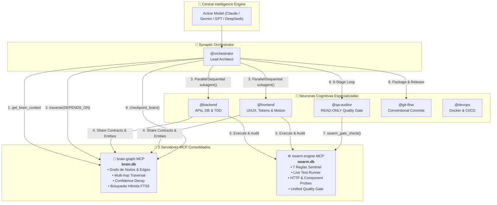
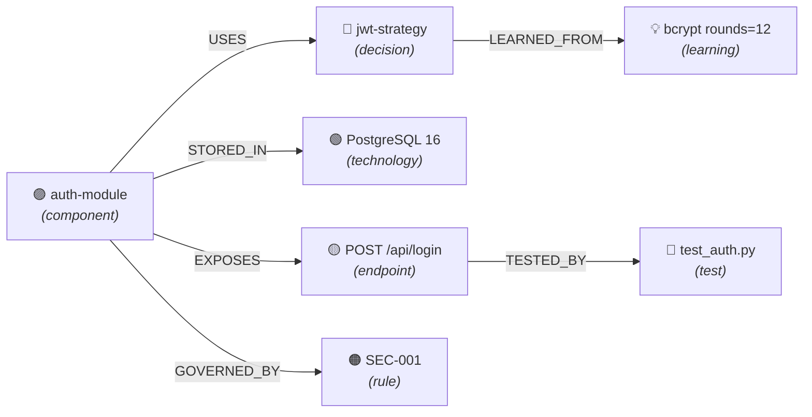

# 🧠 OpenCode Neural Swarm v2

> **Autonomous Multi-Agent Orchestration Framework with Obsidian-Style Neural Brain & Consolidated Operational Engine**

[](https://opencode.ai)
[](config/SWARM.md)
[](mcp/swarm-engine/)
[](mcp/)

---

## 1. Visión General: De Memoria Plana a Cerebro Neural

**OpenCode Swarm v2** transforma el entorno de desarrollo de OpenCode en un enjambre de ingeniería de software autónomo y de alto rendimiento. En lugar de ejecutar agentes en silos o recurrir a memorias planas clave-valor que sufren de amnesia o saturación de contexto, Swarm v2 implementa:

1. **🧠 Cerebro Neural en Grafo (`brain-graph`)**: Un grafo de conocimiento local persistente (SQLite WAL + FTS5) inspirado en **Obsidian**, donde decisiones, componentes, endpoints, reglas y tests son **nodos interconectados por sinapsis tipadas** (`USES`, `DEPENDS_ON`, `TESTED_BY`, `GOVERNED_BY`, etc.).
2. **⚙️ Motor Operacional Unificado (`swarm-engine`)**: Una sola capa de ejecución que consolida **Sentinel** (auditoría de reglas de calidad), **Live Tester** (ejecutor de pruebas multilingüe con detección de cobertura) y **Task Gates** (compuertas de certificación de producción).
3. **⚡ Pipeline Reactivo con Despacho Paralelo**: El orquestador consulta las relaciones en el grafo antes de despachar subagentes. Si no existen dependencias directas de contrato, ejecuta `@backend` y `@frontend` en paralelo, reduciendo los tiempos de ciclo entre un 30% y 40%.
4. **📦 Protocolo de Retorno Comprimido (Return Compression)**: Cada subagente devuelve exclusivamente un resumen de alto valor técnico (máximo 400 tokens), evitando el agotamiento de la ventana de contexto durante tareas complejas.

---

## 2. Diagrama de Arquitectura del Sistema



---

## 3. El Cerebro Neural (`brain-graph` MCP)

El cerebro neural almacena el conocimiento arquitectónico como un **grafo conectado**, no como texto plano. Permite responder preguntas complejas navegando relaciones:



### Vocabulario de Nodos y Relaciones
- **Tipos de Nodos**: `concept`, `decision`, `component`, `endpoint`, `file`, `test`, `rule`, `learning`, `technology`, `agent`, `task`, `checkpoint`, `bug`.
- **Relaciones Tipadas**: `USES`, `DEPENDS_ON`, `TESTED_BY`, `GOVERNED_BY`, `EXPOSES`, `IMPLEMENTS`, `CONTRADICTS`, `SUPERSEDES`, `LEARNED_FROM`, `PART_OF`, `EXTENDS`, `REQUIRES`.

### Confidence Decay: Olvido Inteligente
Para prevenir que el grafo acumule notas obsoletas o registros temporales que contaminen el contexto, el sistema implementa decaimiento exponencial:

$$\text{confidence}(t) = \text{confidence}_0 \times e^{-\lambda \times \Delta t_{\text{días}}}$$

- **`decay_audit(dry_run=True)`**: Audita nodos inactivos y su nivel de confianza actual.
- **`decay_audit(dry_run=False, prune_threshold=0.15)`**: Poda automáticamente información obsoleta no consultada.

### Herramientas del Cerebro (`brain-graph`)

| Herramienta | Propósito |
|---|---|
| `get_brain_context(project)` | Hidratación ultrarrápida al inicio de sesión con nodos clave y observaciones. |
| `create_entity(id, title, node_type, content, tags)` | Registra una unidad atómica de conocimiento o decisión técnica. |
| `relate(source, target, relation, reason)` | Crea una sinapsis tipada y dirigida entre dos nodos. |
| `observe(node_id, observation, observer)` | Añade hechos granulares a un nodo existente sin tener que reescribirlo. |
| `traverse(start_node, depth, relation)` | Navega el grafo N saltos para inspeccionar dependencias y vecinos. |
| `recall_graph(query, expand_neighbors)` | Búsqueda híbrida: coincide por FTS5 y expande los nodos conectados. |
| `record_learning(lesson, trigger_node)` | Almacena aprendizajes y gotchas de ingeniería conectados al nodo origen. |
| `checkpoint_brain(summary, files_modified)` | Guarda un snapshot del estado del proyecto para reanudación inmediata. |
| `decay_audit(dry_run, prune_threshold)` | Audita y poda nodos con baja confianza o inactivos. |
| `list_entities(node_type)` | Lista todos los conceptos o filtra por categoría. |

---

## 4. Motor Operacional (`swarm-engine` MCP)

Unifica la supervisión de reglas de calidad, la ejecución de tests y las compuertas de entrega en un solo motor de alta velocidad.

### Las 7 Reglas Inmutables de Ingeniería (Sentinel)

| Código | Regla | Responsable | Severidad | Descripción |
|---|---|---|---|---|
| **`TDD-001`** | Test-Driven Development | `@backend` | Critical | Pruebas unitarias obligatorias con cobertura $\ge 80\%$. |
| **`VERIF-001`** | 6-Stage Verification Loop | `@qa-auditor` | Critical | Ciclo de 6 etapas (Build, Types, Lint, Tests, Security, Regresiones). |
| **`GIT-001`** | Conventional Commits 1.0 | `@git-flow` | High | Mensajes semánticos (`feat:`, `fix:`, etc.) y árbol git limpio. |
| **`UI-001`** | Anti-Slop & Tactile Motion | `@frontend` | High | Tokens OKLCH, física de resortes, accesibilidad WCAG AA. |
| **`SEC-001`** | Zero Hardcoded Secrets | Todos | Critical | Cero secretos en código; validación en frontera y consultas preparadas. |
| **`ARCH-001`** | Clean Architecture & SRP | Todos | High | Principio de responsabilidad única, modularidad ($<800$ líneas). |
| **`HANDOFF-001`** | Formal Shared Contracts | Todos | High | Contratos publicados vía `swarm_share_artifact` antes de handoffs. |

### Herramientas del Motor (`swarm-engine`)

| Herramienta | Propósito |
|---|---|
| `sentinel_audit_task(...)` | Audita entregables contra las reglas activas y emite calificación (0-100). |
| `sentinel_get_rules(...)` | Consulta el catálogo de reglas de ingeniería y sus listas de verificación. |
| `sentinel_verify_compliance(...)` | Verifica si existen violaciones abiertas bloqueando el avance. |
| `tester_run_suite(...)` | Detecta y ejecuta runners (`pytest`, `vitest`, `jest`, `cargo`, `go`) y parsea cobertura. |
| `tester_probe_endpoint(...)` | Mide latencia HTTP y comprueba códigos de respuesta en endpoints en vivo. |
| `tester_verify_component(...)` | Validación estática y sintáctica de archivos antes de pruebas completas. |
| `swarm_post_task(...)` | Publica hitos en el tablero compartido de tareas. |
| `swarm_update_task(...)` | Actualiza estado de tarea (`todo`, `in_progress`, `done`, `blocked`). |
| `swarm_share_artifact(...)` | Publica especificaciones o contratos compartidos (API, esquemas de DB). |
| `swarm_gate_check(...)` | **Unified Quality Gate**: Valida tareas completadas + tests verdes + 0 violaciones críticas. |

---

## 5. Roster de Neuronas Especializadas

Cada agente es un archivo markdown en `agents/` configurado con su prompt de sistema, habilidades y restricciones:

- **`@orchestrator`** (`agents/orchestrator.md`): Lead Architect. Descompone requerimientos, consulta el grafo de conocimiento para decidir paralelismo, coordina subagentes y certifica las entregas.
- **`@backend`** (`agents/backend.md`): Especialista en APIs, bases de datos (PostgreSQL, Prisma, MySQL, ClickHouse) y TDD con cobertura $\ge 80\%$. Publica contratos de datos formalmente.
- **`@frontend`** (`agents/frontend.md`): Especialista en UI/UX, sistemas de diseño, accesibilidad WCAG AA y micro-interacciones con física de resortes (anti-slop).
- **`@qa-auditor`** (`agents/qa-auditor.md`): **READ-ONLY INVARIANT**. Jamás modifica código de producción. Ejecuta el bucle de 6 etapas, audita seguridad OWASP y emite el scorecard de certificación.
- **`@git-flow`** (`agents/git-flow.md`): Gestor de control de versiones. Aplica Conventional Commits 1.0, garantiza ramas limpias y prepara notas de versión.
- **`@devops`** (`agents/devops.md`): Infraestructura, Dockerfiles multi-stage rootless, Compose y pipelines CI/CD.

---

## 6. Comandos Slash en el Chat

Interactúa directamente con el cerebro y el enjambre desde el chat de OpenCode:

| Comando | Descripción |
|---|---|
| `/graph` o `/graph-brain` | Consulta, navega y busca en el grafo de conocimiento (`/graph traverse auth-module`, `/graph search JWT`). |
| `/memory` | Busca decisiones arquitectónicas, convenciones y aprendizajes del proyecto. |
| `/tasks` | Inspecciona el tablero de tareas persistente (`/tasks add "Crear modelo User"`, `/tasks`). |
| `/live` | Monitor de telemetría multi-ventana en tiempo real. |
| `/handoff` | Consulta contratos y especificaciones compartidas entre agentes. |

---

## 7. Instalación y Puesta en Marcha

### Prerrequisitos
- Sistema operativo: **Linux** o **macOS**
- Bash 4.0 o superior
- Python 3.10+ (con módulo `sqlite3`)
- CLI de OpenCode instalada (`opencode`) o Claude Code (`claude`)

### Instalación en 1 Paso

Clona el repositorio e inicia el asistente de instalación interactivo:

```bash
git clone https://github.com/anthra123x/opencode_config.git ~/.opencode
cd ~/.opencode
./install.sh
```

El instalador:
1. Verifica automáticamente prerrequisitos (Bash 4+, Python 3, SQLite FTS5).
2. Crea un respaldo automático de configuraciones previas.
3. Despliega las 6 neuronas cognitivas en `~/.opencode/agents/`.
4. Instala los 2 servidores MCP (`brain-graph` y `swarm-engine`) con ejecutables en `~/.local/bin/`.
5. Instala las 34 skills de ingeniería y el protocolo unificado `SWARM.md`.
6. Configura el tema visual TokioNight para la terminal.

### Verificación del Sistema

Verifica que todo esté correctamente instalado ejecutando:

```bash
# Diagnóstico completo de componentes y dependencias
ecc doctor

# Estado de agentes, servidores MCP y base de datos
ecc status

# Validación sintáctica de archivos de configuración
ecc validate
```

---

## 8. Estructura del Repositorio

```text
opencode_config/
├── agents/                       # Definiciones de neuronas cognitivas
│   ├── orchestrator.md           # Lead Architect & Coordinador
│   ├── backend.md                # Especialista Backend & TDD
│   ├── frontend.md               # Especialista Frontend & UI/UX
│   ├── qa-auditor.md             # Auditor QA (Read-Only)
│   ├── git-flow.md               # GitFlow & Versionado
│   └── devops.md                 # DevOps & Contenedores
├── config/                       # Configuraciones y protocolos
│   ├── SWARM.md                  # Protocolo Operacional Swarm v2 (Single Source of Truth)
│   ├── INSTRUCTIONS.md           # Directivas metodológicas
│   ├── AGENTS.md                 # Protocolos de coordinación
│   ├── opencode.jsonc            # Configuración principal de OpenCode
│   ├── opencode.json             # MCP runtime bindings
│   ├── tui.json                  # Tema visual TokyoNight
│   └── commands/                 # Slash commands (/graph, /tasks, /memory, /live)
├── mcp/                          # Servidores MCP nativos
│   ├── brain-graph/              # 🧠 Cerebro Neural (Memoria estilo Obsidian)
│   │   ├── server.py             # Servidor MCP (13 herramientas de grafo)
│   │   ├── schema.sql            # Esquema SQL documentado
│   │   ├── migrate.py            # Migrador de memorias v1 a grafo v2
│   │   └── test_server.py        # Suite de pruebas unitarias (30 tests)
│   └── swarm-engine/             # ⚙️ Motor Operacional (Sentinel + Tester + Tasks)
│       ├── server.py             # Servidor MCP unificado
│       ├── schema.sql            # Esquema SQL de operaciones
│       └── test_server.py        # Suite de pruebas unitarias (13 tests)
├── ecc                           # Herramienta CLI de administración
├── install.sh                    # Asistente de instalación interactivo
├── lib/                          # Bibliotecas utilitarias Bash
└── skills/                       # 34 Skills especializadas de ingeniería
```

---

## 9. Pruebas Unitarias

Ambos servidores MCP cuentan con suites de pruebas completas que garantizan cero regresiones:

```bash
# Probar el Cerebro Neural (30 tests)
python3 -m unittest mcp/brain-graph/test_server.py -v

# Probar el Motor Operacional (13 tests)
python3 -m unittest mcp/swarm-engine/test_server.py -v
```

**Resultado actual**: **43/43 tests passing** (100% éxito).

---

## 10. Licencia

Distribuido bajo la licencia MIT. Diseñado para potenciar el desarrollo autónomo de software con OpenCode y modelos de lenguaje de vanguardia.
