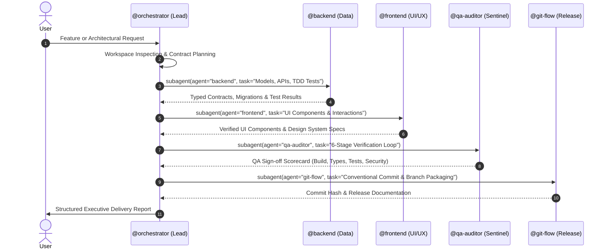

# OpenCode Neural Swarm Architecture

Enterprise-grade multi-agent orchestration framework for OpenCode. Transforms the standard development environment into an autonomous cognitive swarm driven by specialized, domain-isolated neural agents and high-throughput workflows.

---

## 1. Executive Summary

OpenCode Neural Swarm shifts agentic coding from brittle, high-latency remote procedure calls (MCP STDIO/IPC) to direct, high-throughput cognitive workflows. 

The framework operates under a unified paradigm:
- **Central Intelligence Engine**: The active AI model selected in OpenCode (Claude, Gemini, GPT, DeepSeek, etc.) serves as the computational core.
- **Specialized Cognitive Neurons**: Distinct sub-agents (`@orchestrator`, `@backend`, `@frontend`, `@qa-auditor`, `@git-flow`, `@devops`) act as domain-specific neural nodes. Each operates under strict behavioral constraints, specialized heuristics, and direct tool permissions.
- **Direct Synaptic Workflows**: Deterministic, pipeline-based execution where the Lead Architect activates specialized neurons end-to-end via native tool execution (`subagent`), eliminating IPC overhead and manual intervention.
- **Zero-Compaction State Retention**: Memory checkpoints and architectural decisions persist across project sessions without destructive context summarization.

---

## 2. The Cognitive Neuron Paradigm

Traditional agent frameworks suffer from protocol latency, IPC socket errors, and context bloat caused by redundant RPC roundtrips. The Neural Swarm model replaces external RPC daemons with direct cognitive execution:

```text
                               [ Active AI Engine ]
                                        |
                 +----------------------+----------------------+
                 |                      |                      |
                 v                      v                      v
        [ Lead Orchestrator ]   [ Backend Neuron ]    [ Frontend Neuron ]
         - Architecture          - API Contracts       - Design Systems
         - Task Decomposition    - DB Migrations       - Component Motion
         - Pipeline Control      - TDD (>=80%)         - WCAG AA A11y
                 |                      |                      |
                 +----------------------+----------------------+
                                        |
                 +----------------------+----------------------+
                 |                      |                      |
                 v                      v                      v
        [ QA/Sentinel Neuron ]   [ GitFlow Neuron ]    [ DevOps Neuron ]
         - 6-Stage Loop          - Conventional 1.0    - Multi-stage Docker
         - OWASP Security        - Clean Branches      - Rootless Containers
         - Regression Defense    - PR Documentation    - CI/CD Pipelines
```

### Key Principles:
1. **Engine Agnostic**: The system adapts seamlessly to whatever model powers the OpenCode session.
2. **Deterministic Handoffs**: Structured specifications and typed data contracts serve as synaptic bridges between neurons.
3. **Execution Continuity**: Neurons iterate autonomously through completion rather than halting prematurely for manual user switching.

---

## 3. Specialized Cognitive Neuron Roster

| Neuron | Mode | Palette | Domain & Responsibilities |
|---|---|---|---|
| `@orchestrator` | `primary` | `#8B5CF6` | **System Architect & Synaptic Coordinator**: Analyzes requirements, defines contracts, maps dependencies, and executes subagent pipelines. |
| `@backend` | `all` | `#3B82F6` | **Data Architecture & Server Logic**: Constructs robust REST/RPC APIs, Prisma/Postgres/MySQL models, migrations, and TDD unit tests (>=80% coverage). |
| `@frontend` | `all` | `#EC4899` | **Interface & UX Engineering**: Designs responsive UI components, enforces design tokens, implements spring motion physics, and guarantees accessibility. |
| `@qa-auditor` | `all` | `#F59E0B` | **QA & Sentinel Quality Gate**: Executes the 6-stage verification loop, enforces OWASP security hygiene, and certifies production readiness. |
| `@git-flow` | `all` | `#10B981` | **Release & Version Control**: Enforces Conventional Commits 1.0, clean branch topologies, pull request documentation, and conflict resolution. |
| `@devops` | `all` | `#06B6D4` | **Infrastructure & Containers**: Authors lean multi-stage Dockerfiles, rootless execution profiles, Compose topologies, and CI/CD automation. |

---

## 4. Synaptic Workflows & Execution Pipeline

When a user issues an objective, `@orchestrator` drives the delivery through a sequential, deterministic pipeline:



---

## 5. Quality Assurance & The 6-Stage Sentinel Loop

All code delivered by the swarm must pass the rigorous 6-Stage Sentinel Verification Loop enforced by `@qa-auditor`:

1. **Stage 1: Build & Syntax Integrity**
   - Clean compilation without syntax errors across all target runtimes (`npm run build`, `python -m py_compile`, `cargo check`).
2. **Stage 2: Static Type Safety**
   - Strict type evaluation (`tsc --noEmit`, `pyright`, `mypy`). Zero untyped dictionaries or `any` escapes.
3. **Stage 3: Linting & Code Hygiene**
   - Automated formatting and linting conformance (`biome check`, `eslint`, `ruff`).
4. **Stage 4: Test-Driven Verification (TDD)**
   - Test suites execute against real logic. Minimum threshold of 80% coverage across business logic.
5. **Stage 5: Defensive Security Audit (OWASP)**
   - Verification of prepared queries/ORMs (SQL injection defense), input sanitization, strict CORS/CSP configurations, and zero committed secrets.
6. **Stage 6: AI Regression Defense**
   - Detection of common AI coding blind spots: unhandled edge cases, empty catch blocks, race conditions, and unhandled promises.

---

## 6. Terminal Interface & Customization

OpenCode Swarm integrates directly into the terminal interface:

- **ASCII Interface Header**: Clean typographic identity displayed on session initialization.
- **Prompt Status**: Displays active workspace branch and repository path directly beneath the interactive prompt.
- **TokyoNight Palette**: High-contrast, dark terminal palette with stacked diff visualization (`diff_style: "stacked"`).
- **Process Isolation**: Terminal tabs are dynamically tagged with ANSI OSC sequences indicating the active workspace.

---

## 7. Real-Time Terminal Monitoring & Swarm Telemetry

The framework provides real-time multi-agent activity monitoring directly within the CLI:

- **Per-Project Isolation**: Compound primary keys guarantee dedicated agent states and tasks per workspace.
- **Multi-Window Live Monitor**: `ecc live --watch` displays active windows, current tasks, and recent handoffs in real time.
- **Sentinel Scorecard**: `ecc sentinel --rules` verifies QA audit compliance, security checks, and code standards.
- **Zero Daemon Overhead**: Operates entirely through native SQLite databases and standard Unix pipes without background servers.

---

## 8. CLI Management Tool: `ecc`

The `ecc` command-line utility provides administrative controls for the framework:

```text
Usage: ecc <command> [options]

Core Commands:
  status           Report active session, agent states, and MCP health
  live             Real-time multi-window swarm monitor (use --watch)
  team             Display multi-agent team board and active tasks
  test             Real-time test suite runner and endpoint probing
  memory           Query persistent context memory and learned instincts
  sentinel         Inspect development rules and audit compliance
  validate         Verify syntax and configuration integrity
  configure        Re-run the configuration wizard
  help             Display command reference
```

---

## 9. Installation & Deployment

### Prerequisites
- Linux or macOS environment
- Bash 4.0 or higher
- Python 3.10+
- OpenCode CLI (`opencode`)

### Installation Command
Run the installer from within the repository root:
```bash
./install.sh
```

The installer verifies dependencies, backs up existing configurations, deploys cognitive neuron definitions, sets up the TokyoNight profile, and configures the launcher wrappers in `~/.local/bin/`.

---

## 10. Repository Architecture

```text
opencode_config/
├── agents/                  # Cognitive neuron prompt definitions
│   ├── orchestrator.md      # Synaptic Lead Architect
│   ├── backend.md           # Backend & Data Specialist
│   ├── frontend.md          # Frontend & UI/UX Specialist
│   ├── qa-auditor.md        # QA & Sentinel Auditor
│   ├── git-flow.md          # Release & Version Control
│   └── devops.md            # Infrastructure & Containers
├── config/                  # Core configuration templates
│   ├── opencode.jsonc       # Primary OpenCode configuration
│   ├── opencode.json        # MCP runtime bindings
│   ├── tui.json             # TokyoNight TUI visual theme
│   ├── INSTRUCTIONS.md      # Methodological directives
│   └── AGENTS.md            # Multi-agent coordination protocols
├── ecc                      # CLI management utility
├── install.sh               # System setup installer
├── lib/                     # Bash utility libraries
├── mcp/                     # Native protocol servers
├── scripts/                 # Maintenance & patch utilities
├── skills/                  # Specialized engineering skills
└── templates/               # Session launcher wrappers
```

---

## 11. System Health & Installation Verification

To verify the installation on any host machine:

```bash
# Run comprehensive diagnostic checks
ecc doctor

# Inspect active agents, MCP servers, and skills
ecc status

# Verify configuration integrity
ecc validate
```

The `ecc doctor` and `ecc validate` commands verify system requirements, SQLite FTS5 capability, subagent configurations, and MCP bindings across any Linux or macOS environment.
