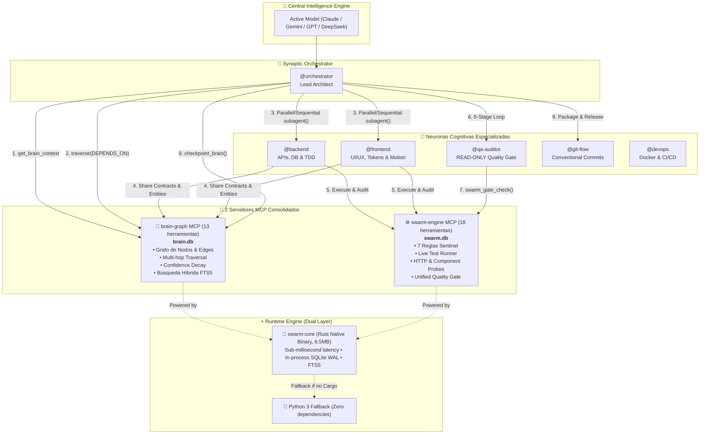
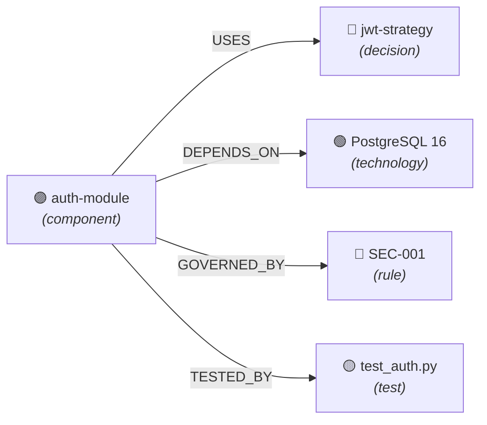

# 🧠 OpenCode Neural Swarm v2

> **Autonomous Multi-Agent Orchestration Framework with Native Rust Core, Obsidian-Style Neural Brain & Consolidated Operational Engine**

[](https://opencode.ai)
[](config/SWARM.md)
[](swarm-core/)
[](mcp/swarm-engine/)
[](mcp/)
[](LICENSE)

---

## 1. Visión General: De Memoria Plana a Cerebro Neural

**OpenCode Swarm v2** transforma el entorno de desarrollo de OpenCode en un enjambre de ingeniería de software autónomo y de alto rendimiento. En lugar de ejecutar agentes en silos o recurrir a memorias planas clave-valor que sufren de amnesia o saturación de contexto, Swarm v2 implementa:

1. **⚡ Motor Nativo en Rust (`swarm-core`)**: Un núcleo standalone compilado en Rust de solo 6.5 MB con despacho JSON-RPC sub-milisegundo y consumo de memoria ínfimo (~6 MB RSS). Incluye SQLite embebido en modo WAL con FTS5, `busy_timeout` de 30 segundos y cero dependencias de sistema.
2. **🧠 Cerebro Neural en Grafo (`brain-graph`)**: Un grafo de conocimiento local persistente inspirado en **Obsidian**, donde decisiones, componentes, endpoints, reglas y tests son **nodos interconectados por sinapsis tipadas** (`USES`, `DEPENDS_ON`, `TESTED_BY`, `GOVERNED_BY`, etc.).
3. **⚙️ Motor Operacional Unificado (`swarm-engine`)**: Una sola capa de ejecución que consolida **Sentinel** (auditoría de reglas de calidad), **Live Tester** (ejecutor de pruebas multilingüe con detección de cobertura) y **Task Gates** (compuertas de certificación de producción).
4. **🌐 Portabilidad Universal y Arquitectura Dual**: Diseñado para funcionar en cualquier equipo (Linux, macOS, WSL). Si Rust (`cargo`) está disponible, se compila e instala el binario optimizado; si no, conmuta de forma 100% transparente a los servidores en Python 3 estándar sin requerir `pip` ni dependencias externas.
5. **⚡ Pipeline Reactivo con Despacho Paralelo**: El orquestador consulta las relaciones en el grafo antes de despachar subagentes. Si no existen dependencias directas de contrato, ejecuta `@backend` y `@frontend` en paralelo, reduciendo los tiempos de ciclo entre un 30% y 40%.
6. **📦 Protocolo de Retorno Comprimido (Return Compression)**: Cada subagente devuelve exclusivamente un resumen de alto valor técnico (máximo 400 tokens), evitando el agotamiento de la ventana de contexto durante tareas complejas.

---

## 2. Diagrama de Arquitectura del Sistema



---

## 3. El Cerebro Neural (`brain-graph` MCP)

El cerebro neural almacena el conocimiento arquitectónico como un **grafo conectado**, no como texto plano. Permite responder preguntas complejas navegando relaciones:



### Herramientas del Grafo (13 herramientas):

| Herramienta | Propósito | Operación |
|---|---|---|
| `create_entity` | Registrar nuevo concepto, decisión, componente o regla | Escritura |
| `relate` | Conectar 2 nodos con sinapsis tipada y dirigida | Escritura |
| `observe` | Anotar observación sin reescribir el contenido del nodo | Escritura |
| `traverse` | Recorrer el grafo hasta $N$ saltos siguiendo aristas | Lectura |
| `recall_graph` | Búsqueda híbrida (FTS5 + expansión de vecinos) | Lectura |
| `get_brain_context` | Snapshot consolidado del proyecto para inicio de sesión | Lectura |
| `decay_audit` | Auditoría y purga de confianza por desuso exponencial | Mantenimiento |
| `record_learning` | Registrar lección aprendida tras resolver un problema | Aprendizaje |
| `checkpoint_brain` | Punto de control de sesión con lista de cambios | Checkpoint |
| `delete_entity` | Eliminar nodo y desconectar sus aristas | Mantenimiento |
| `remove_relation` | Eliminar sinapsis específica entre 2 nodos | Mantenimiento |
| `merge_nodes` | Fusionar dos nodos duplicados conservando conexiones | Mantenimiento |
| `list_entities` | Listar nodos filtrando por tipo, confianza o proyecto | Lectura |

### Vocabulario de Sinapsis Tipadas:
`USES`, `DEPENDS_ON`, `TESTED_BY`, `GOVERNED_BY`, `EXPOSES`, `IMPLEMENTS`, `CONTRADICTS`, `SUPERSEDES`, `LEARNED_FROM`, `PART_OF`, `EXTENDS`, `REQUIRES`.

---

## 4. El Motor Operacional (`swarm-engine` MCP)

Consolida en un solo servidor MCP las funciones de calidad, pruebas en tiempo real y tablero de hitos:

```
┌────────────────────────────────────────────────────────┐
│                   ⚙️ SWARM-ENGINE                      │
├───────────────────┬───────────────────┬────────────────┤
│   🛡️ SENTINEL     │    🧪 TESTER      │   📋 TASKS     │
│  7 Reglas de      │  Runner multilang │  Tablero de    │
│  Ingeniería       │  Probes HTTP      │  Hitos         │
│  Auditoría Continua│  Sintaxis & AST   │  Artefactos    │
│  Scorecards       │  Live Health      │  Quality Gate  │
└───────────────────┴───────────────────┴────────────────┘
```

### Las 7 Reglas Inmutables de Sentinel:
1. **`TDD-001`**: Cobertura obligatoria $\ge 80\%$ y pruebas automatizadas previas.
2. **`VERIF-001`**: Bucle de verificación de 6 etapas (Build, Types, Lint, Tests, Security OWASP, Regresiones).
3. **`GIT-001`**: Conventional Commits 1.0 (`feat:`, `fix:`, `refactor:`, etc.) y árbol limpio.
4. **`UI-001`**: Anti-slop UI, diseño curado, tokens OKLCH, física de resortes y WCAG AA.
5. **`SEC-001`**: Cero secretos hardcodeados, saneamiento en frontera y parámetros preparados.
6. **`ARCH-001`**: Principio de Responsabilidad Única, archivos modulares $<800$ líneas y errores tipados.
7. **`HANDOFF-001`**: Contratos formales compartidos (`swarm_share_artifact`) antes de pasar la posta.

### Herramientas Operacionales (18 herramientas):

| Módulo | Herramientas Clave |
|---|---|
| **Tablero & Gate** | `swarm_post_task`, `swarm_update_task`, `swarm_list_tasks`, `swarm_share_artifact`, `swarm_get_artifact`, `swarm_gate_check` |
| **Sentinel** | `sentinel_audit_task`, `sentinel_get_rules`, `sentinel_record_violation`, `sentinel_resolve_violation`, `sentinel_verify_compliance`, `sentinel_get_compliance_report` |
| **Tester** | `tester_run_suite`, `tester_probe_endpoint`, `tester_verify_component`, `tester_get_live_health`, `tester_quick_check`, `tester_sync_with_sentinel` |

---

## 5. Roster de Neuronas Especializadas

OpenCode permite alternar entre las neuronas cognitivas instantáneamente con la tecla **`TAB`**:

| Agente | Modo | Color TUI | Rol y Especialidad |
|---|---|---|---|
| **`@orchestrator`** | `primary` (TAB) | `#8B5CF6` (Morado) | **Lead Architect**: Descompone metas, consulta el grafo, delega tareas en paralelo y certifica entregables. |
| **`@backend`** | `primary` (TAB) | `#3B82F6` (Azul) | **Backend Engineer**: APIs REST, esquemas de BD, migraciones, TDD con cobertura $\ge 80\%$. |
| **`@frontend`** | `primary` (TAB) | `#EC4899` (Rosa) | **UI/UX Engineer**: Interfaces táctiles, tokens OKLCH, micro-animaciones, diseño anti-slop. |
| **`@qa-auditor`** | `primary` (TAB) | `#F59E0B` (Ámbar) | **Auditor de Calidad (Read-Only)**: Verificación en 6 etapas, OWASP, regresiones. |
| **`@git-flow`** | `primary` (TAB) | `#10B981` (Verde) | **Git Master**: Commits convencionales 1.0, ramas, resolución de conflictos y PRs. |
| **`@devops`** | `subagent` | `#06B6D4` (Cian) | **Infraestructura**: Dockerfiles multi-stage, Docker Compose, CI/CD. |

---

## 6. Instalación y Portabilidad Universal

El sistema incluye detección automática de plataforma y auto-compilación para garantizar instalación inmediata en cualquier equipo:

### Instalación en 1 Línea

```bash
git clone https://github.com/anthra123x/opencode_config.git ~/.opencode
cd ~/.opencode
./install.sh -y
```

### Características de Portabilidad:
- **Auto-compilación en Rust**: Si `cargo` está presente, compila automáticamente `swarm-core` en modo release (`target/release/swarm-core`) y lo instala en `~/.local/bin/`.
- **Fallback Automático a Python 3**: Si `cargo` no está disponible, el instalador conmuta de inmediato a los servidores Python 3 estándar (cero `pip install` requeridos, solo biblioteca estándar).
- **Reemplazo Atómico de Binarios**: Utiliza un staging temporal (`.tmp -> mv -f`) inmune al error `ETXTBSY` (Text file busy) incluso si OpenCode está activo durante la actualización.
- **Wrappers Auto-Resilientes**: Los lanzadores `opencode-brain-graph` y `opencode-swarm-engine` auto-detectan `swarm-core` en `PATH` o en `~/.local/bin/` y conmutan al runtime óptimo sin intervención manual.

### Verificación del Sistema

```bash
# Diagnóstico completo de componentes y dependencias
ecc doctor

# Diagnóstico del motor nativo en Rust
swarm-core doctor

# Estado de agentes, servidores MCP y base de datos
ecc status
```

---

## 7. Estructura del Repositorio

```text
opencode_config/
├── LICENSE                       # Licencia MIT (Copyright (c) 2026 anthra123x)
├── README.md                     # Documentación principal de arquitectura
├── ecc                           # CLI de administración, diagnóstico y monitoreo
├── install.sh                    # Instalador interactivo y desatendido (-y)
├── swarm-core/                   # 🦀 Motor nativo standalone en Rust
│   ├── Cargo.toml                # Metadatos y dependencias (rusqlite, serde, ureq)
│   └── src/
│       ├── main.rs               # Dispatcher CLI y stdio JSON-RPC
│       ├── mcp/                  # Protocolo MCP 2.0 (brain_server, engine_server)
│       ├── brain/                # Grafo de conocimiento SQLite WAL + FTS5
│       ├── engine/               # Tablero de tareas, artefactos y compuertas
│       ├── sentinel/             # Las 7 reglas inmutables de calidad
│       ├── tester/               # Runner de suites, probes HTTP y AST
│       └── cli/                  # Subcomandos doctor, status, migrate
├── mcp/                          # 🐍 Servidores MCP nativos en Python (Fallback)
│   ├── brain-graph/              # Cerebro Neural (server.py, 30 tests)
│   └── swarm-engine/             # Motor Operacional (server.py, 13 tests)
├── agents/                       # Definiciones de neuronas cognitivas
│   ├── orchestrator.md           # Lead Architect & Coordinador
│   ├── backend.md                # Especialista Backend & TDD
│   ├── frontend.md               # Especialista Frontend & UI/UX
│   ├── qa-auditor.md             # Auditor QA (Read-Only)
│   ├── git-flow.md               # GitFlow & Versionado
│   └── devops.md                 # DevOps & Contenedores
├── config/                       # Configuraciones y protocolos
│   ├── SWARM.md                  # Protocolo Operacional Swarm v2 (Single Source of Truth)
│   ├── INSTRUCTIONS.md           # Directivas metodológicas y handoffs
│   ├── AGENTS.md                 # Protocolos de coordinación
│   ├── opencode.jsonc            # Configuración de agentes y servidores MCP
│   ├── opencode.json             # MCP runtime bindings
│   └── tui.json                  # Tema visual TokyoNight
├── lib/                          # Bibliotecas utilitarias Bash
└── skills/                       # 34 Skills especializadas de ingeniería
```

---

## 8. Pruebas y Validación Continua

Tanto el motor en Rust como los servidores Python cuentan con cobertura completa de pruebas:

```bash
# Probar el motor nativo en Rust
cd swarm-core && cargo test

# Probar el Cerebro Neural en Python (30 tests)
python3 -m unittest mcp/brain-graph/test_server.py -v

# Probar el Motor Operacional en Python (13 tests)
python3 -m unittest mcp/swarm-engine/test_server.py -v
```

---

## 9. Licencia

Distribuido bajo la **Licencia MIT**. Copyright (c) 2026 **anthra123x**.

Para más información, consulta el archivo [LICENSE](LICENSE).
