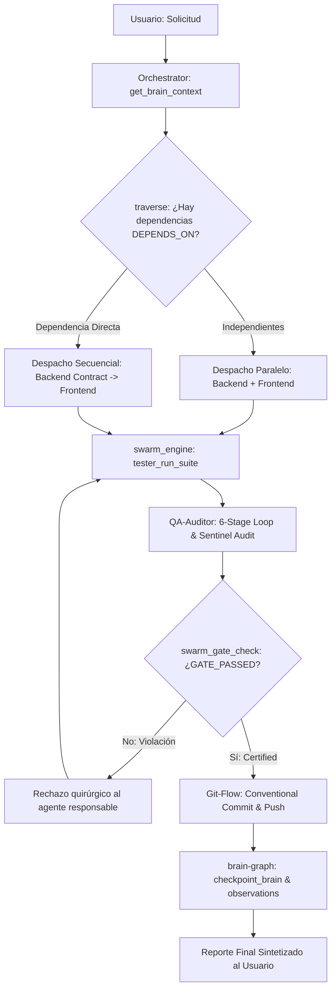

# OpenCode Swarm v2 — Protocolo Operacional y Arquitectura

Este documento establece el protocolo de coordinación multi-agente, la memoria en grafo de conocimiento y las compuertas de calidad de OpenCode Swarm v2.

---

## 1. Arquitectura Consolidada: 2 Servidores MCP

```
┌────────────────────────────────────────────────────────┐
│                   🤖 ORCHESTRATOR                      │
└───────────────┬────────────────────────┬───────────────┘
                │                        │
       (Memoria y Contexto)      (Ejecución y Calidad)
                ▼                        ▼
┌───────────────────────────────┐ ┌───────────────────────────────┐
│        🧠 brain-graph         │ │       ⚙️ swarm-engine         │
│  Knowledge Graph (brain.db)   │ │  Sentinel + Tester + Tasks    │
├───────────────────────────────┤ ├───────────────────────────────┤
│ • Nodos tipados & sinapsis    │ │ • 7 Reglas Sentinel           │
│ • Traversal multi-hop         │ │ • Ejecutor de tests multilang │
│ • Búsqueda híbrida FTS5       │ │ • Probes HTTP y sintaxis      │
│ • Confidence decay automático │ │ • Tablero de tareas/contratos │
│ • Checkpoints & observaciones │ │ • Unified Quality Gate        │
└───────────────────────────────┘ └───────────────────────────────┘
```

1. **`brain-graph`** (`~/.opencode/brain/brain.db`): Memoria persistente estilo Obsidian. Reemplaza la memoria plana clave-valor por un grafo relacional de conceptos, decisiones, componentes, endpoints, reglas y aprendizajes.
2. **`swarm-engine`** (`~/.opencode/swarm/swarm.db`): Motor operacional unificado. Consolida Sentinel (auditoría de reglas), Tester (ejecución y salud en vivo) y el tablero de tareas/artefactos en una sola base SQLite WAL sin duplicación.

---

## 2. Protocolo del Cerebro Neural (`brain-graph`)

### A. Hidratación al Iniciar Sesión
Todo agente (especialmente `@orchestrator`) debe iniciar con:
```python
get_brain_context(project="mi-proyecto")
```
Devuelve un snapshot compacto del estado del proyecto: nodos recientes por tipo, observaciones vivas y último checkpoint.

### B. Ciclo de Vida del Conocimiento
- **Crear entidad**: Registrar conceptos, decisiones, componentes, endpoints o reglas:
  ```python
  create_entity(id="auth-jwt-strategy", title="JWT Auth Strategy", node_type="decision",
                content="Cookies HttpOnly con SameSite=Strict y rotación de tokens", tags="auth, security")
  ```
- **Conectar nodos (Sinapsis)**: Establecer relaciones tipadas y dirigidas:
  ```python
  relate(source="auth-module", target="auth-jwt-strategy", relation="USES", reason="Implementa estrategia JWT")
  relate(source="auth-module", target="test-auth", relation="TESTED_BY")
  relate(source="auth-module", target="sec-001", relation="GOVERNED_BY")
  ```
  *Vocabulario*: `USES`, `DEPENDS_ON`, `TESTED_BY`, `GOVERNED_BY`, `EXPOSES`, `IMPLEMENTS`, `CONTRADICTS`, `SUPERSEDES`, `LEARNED_FROM`, `PART_OF`, `EXTENDS`, `REQUIRES`.
- **Observar sin reescribir**: Evolucionar el estado de un nodo incrementalmente:
  ```python
  observe(node_id="auth-module", observation="MFA TOTP implementado con 12 tests pasando", observer="@backend")
  ```
- **Traversal multi-hop**: Explorar dependencias y vecinos:
  ```python
  traverse(start_node="auth-module", depth=2, relation="DEPENDS_ON")
  ```
- **Búsqueda híbrida (FTS5 + Vecinos)**:
  ```python
  recall_graph(query="auth JWT cookies", expand_neighbors=True)
  ```
- **Aprendizaje continuo**:
  ```python
  record_learning(lesson="Bcrypt requiere rounds >= 12 para producción", trigger_node="auth-module")
  ```
- **Confidence Decay y Poda**:
  ```python
  decay_audit(dry_run=True)   # Auditar nodos obsoletos
  decay_audit(dry_run=False, prune_threshold=0.15)  # Purgar
  ```

---

## 3. Protocolo de Ejecución y Quality Gate (`swarm-engine`)

### A. Las 7 Reglas Inmutables de Ingeniería (Sentinel)
1. **`TDD-001` (Backend)**: Pruebas automatizadas obligatorias con cobertura $\ge 80\%$.
2. **`VERIF-001` (QA Auditor)**: Bucle de verificación de 6 etapas (Build, Types, Lint, Tests, Security OWASP, Regresiones).
3. **`GIT-001` (Git-Flow)**: Conventional Commits 1.0 (`feat:`, `fix:`, `refactor:`, etc.) y árbol git limpio sin logs ni temporales.
4. **`UI-001` (Frontend)**: Anti-slop UI, diseño curado con tokens OKLCH, física de resortes y WCAG AA.
5. **`SEC-001` (Todos)**: Cero secretos en código, saneamiento en frontera y parámetros preparados.
6. **`ARCH-001` (Todos)**: Principio de Responsabilidad Única, archivos modulares $<800$ líneas y manejo tipado de errores.
7. **`HANDOFF-001` (Todos)**: Contratos formales compartidos (`swarm_share_artifact`) antes del handoff entre agentes.

### B. Herramientas de Verificación y Pruebas
- **Ejecutar tests**: `tester_run_suite(runner="pytest|vitest|jest|go|cargo", coverage=True)`
- **Sondear HTTP**: `tester_probe_endpoint(url="http://localhost:3000/api/health", expected_status=200)`
- **Verificar sintaxis**: `tester_verify_component(file_path="src/index.ts")`
- **Auditoría Sentinel**: `sentinel_audit_task(agent_name="backend", task_title="...", deliverables="...", test_results="...")`
- **Compuerta Unificada**: `swarm_gate_check(task_id=1)`: Valida estado de tarea, cobertura de tests y cero infracciones críticas.

---

## 4. Pipeline Reactivo Basado en Grafo



### Protocolo de Retorno Comprimido (Return Compression)
Para evitar la saturación de tokens en sesiones largas:
- Cada subagente invocado vía `subagent()` debe retornar **únicamente un resumen estructurado (máx. 300-400 tokens)**:
  1. **Status**: `DONE` | `PARTIAL` | `BLOCKED`
  2. **Files created/modified**: Lista concisa
  3. **Deliverables/Contract**: Esquemas de endpoints o componentes
  4. **Tests/Coverage**: Porcentajes y aserciones
  5. **Blockers/Decisions**: Puntos clave
- **Queda estrictamente prohibido**: Volcar logs completos de compiladores, diffs masivos, código fuente entero o trazas extensas de pensamiento en la respuesta del subagente.

---

## 5. Roster y Roles Especializados

| Agente | Rol | Invariantes Clave |
|---|---|---|
| `@orchestrator` | Lead Architect & Coordinador | Consulta el grafo antes de despachar, paraleliza tareas independientes, certifica con Quality Gate, mantiene flujo autónomo sin pausas. |
| `@backend` | APIs, Base de Datos, TDD | Aplica TDD ($\ge 80\%$), publica contratos vía `swarm_share_artifact`, conecta endpoints a nodos en `brain-graph`. |
| `@frontend` | UI/UX, Componentes, Motion | Diseño anti-slop, tokens de color, spring physics, accesibilidad WCAG AA, consume contratos de `@backend`. |
| `@qa-auditor` | Auditor de Calidad & Seguridad | **READ-ONLY INVARIANT**: Jamás modifica código de producción. Ejecuta el bucle de 6 etapas, audita OWASP, emite scorecard. |
| `@git-flow` | Versionado y Releases | Aplica Conventional Commits 1.0, valida árbol limpio, prepara releases y gestiona ramas. |
| `@devops` | Infraestructura y CI/CD | Dockerfiles multi-stage rootless, Compose, pipelines CI y escaneos de vulnerabilidades. |

---

## 6. Las 5 Invariantes Inviolables

1. **Continuidad Autónoma**: Jamás detenerse pidiendo confirmación en pasos intermedios ni pedir cambios manuales de pestaña. Concluir la tarea completa de inicio a fin.
2. **Inspección Previa**: Reutilizar componentes y utilidades existentes antes de crear código nuevo. Prohibido duplicar.
3. **Validación Gateada**: Ningún entregable se da por terminado sin pruebas verdes certificadas en `swarm-engine`.
4. **Cero Amnesia**: Registrar cada decisión técnica y aprendizaje en `brain-graph` para que persista entre sesiones.
5. **QA Read-Only**: El auditor nunca es el autor. Separación estricta entre constructor y verificador.
